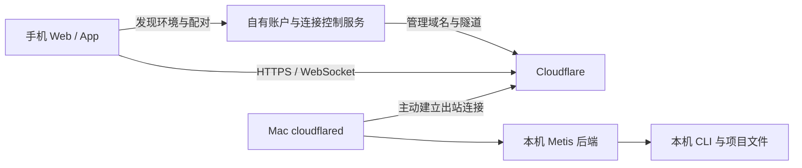

# Metis 手机与远程连接 · 2026-09-23

## 当前范围

设置 → 手机与远程连接已接入 Synara 原有认证接口：管理员生成一次性配对链接、查看/作废待使用链接、查看/撤销设备。配对链接当前 5 分钟有效且只可使用一次，凭据放在 URL fragment，配对页先清除 fragment 再兑换会话。设备撤销不停止电脑上已开始的任务。

Metis 现在提供独立于窗口的共享服务，默认直接使用现有桌面 `.agent-workbench/` 会话数据。电脑 Electron 窗口、浏览器与手机连接同一个服务。首次从旧桌面独占模式切换时先退出旧桌面；之后运行 `npm run metis`，macOS/Linux 会自动启动或连接持续运行的共享服务，再打开桌面，不启动第二个后端。退出桌面不会结束共享服务。原有数据库生命周期锁始终负责最终互斥与恢复，启动器不会删除活跃数据库锁。

桌面附着时校验本机服务文件的权限、工作区路径、进程存活和地址，原生窗口仅允许已配置入口内导航；继续使用原有 Cookie 与一次性配对，没有新增公网认证接口。已有 Electron 登录会话会保留；首次打开可使用本机尚未消费且五分钟内的 owner 链接。若该链接已用于浏览器，请从管理员浏览器生成并复制新配对链接，在桌面弹窗点击「使用已复制的配对链接」。只有点击该按钮后才会读取剪贴板；链接须属于当前入口。共享模式通过已配置 HTTPS 入口连接，因此该模式需要入口可达。后台通过本机私有能力连接 Electron 的浏览器和电脑控制 host；这类工具依赖桌面在线。Windows ACL 验证仍待实现。

本机已配置 `metis.clipmind.tech` 为公网地址，并连接用户创建的 Cloudflare Tunnel。用户已保存指向 `http://127.0.0.1:4785` 的域名路由，公网 HTTPS 健康检查返回正常；已在电脑浏览器打开首次管理员配对链接，设备配对结果和手机跨网体验仍待确认。原生 App、二维码、云端控制服务、系统登录启动和推送尚未接入。手机 [交互稿](mobile-preview/index.html) 仍是示例数据。

## 先在本机运行共享服务

```sh
npm exec --yes --package=bun@1.4.2 -- bun run build:desktop
npm run metis:serve -- --dry-run
npm run metis:serve
```

服务监听 `http://127.0.0.1:4785`，使用构建产物，不需要 Vite。首次管理员链接写入 `.agent-workbench/owner-pairing-url.txt`（仅当前用户可读），在电脑浏览器打开该文件中的链接。链接只可使用一次且 5 分钟后删除本地文件；服务端也强制过期。普通日志遮盖凭据。清理链接不撤销已授权会话。

浏览器页面关闭后服务继续运行。`metis:serve` 默认以前台方式运行，Ctrl+C 会让后端正常结束任务和子进程；加 `-- --background` 可独立在后台运行，默认 `npm run metis` 也采用后台模式。使用 `npm run metis -- --stop-background` 显式停止后台。重开浏览器可使用已授权会话。`.agent-workbench/metis-service.json` 只记录进程、时间、地址和数据目录，不含凭据；后台控制凭据单独保存在仅当前用户可读的文件中。

较大的工作区启动时需要恢复历史运行状态；启动器最多等待后端 3 分钟，外层后台启动命令再预留 15 秒。健康检查就绪且本次后端生成配对链接后才打开桌面。如果超时，检查 `.agent-workbench/metis-background.log`，保留原数据和数据库锁，不要清空工作区。

## 配置公网入口

需要自己管理的 Cloudflare Tunnel、HTTPS 根域名、tunnel token，以及本机 cloudflared。将 tunnel 的 public hostname 指向 `http://127.0.0.1:4785`。本机仍仅监听回环，公网模式强制会话认证与 Secure cookie。

```sh
export METIS_PUBLIC_URL='https://metis.your-domain.example'
export METIS_TUNNEL_TOKEN='<your tunnel token>'
# cloudflared 不在 PATH 时，可设置 METIS_CLOUDFLARED_PATH
npm run metis:remote -- --dry-run
npm run metis:remote
```

`--dry-run` 检查格式、构建与可执行程序，不连接公网，不证明 token 有效。真实启动等待自己创建的后端就绪及配对链接生成，再启动 cloudflared。首次管理员链接仍在相同私有文件中，但指向 HTTPS 域名；在电脑浏览器完成首次配对后，从设置里添加手机。电脑与手机共用该服务的项目和会话。

当前本机网络的 QUIC 连接超时，已在私有启动配置使用 `TUNNEL_TRANSPORT_PROTOCOL=http2`，Cloudflare 连接已成功注册。其他环境可保留默认自动协商；该设置控制 connector 到 Cloudflare 的传输，入口仍使用 HTTPS。参见 [Cloudflare protocol 参数](https://developers.cloudflare.com/cloudflare-one/networks/connectors/cloudflare-tunnel/configure-tunnels/run-parameters/#protocol)。

后端或 connector 退出会结束该模式；cloudflared 处理临时网络断开。不要把未经过 HTTPS 入口的回环端口直接暴露公网。真正验收仍需要异网手机配对、读取同一会话、审批、断网重连与撤销后失效验证；当前未执行这些前端/跨网步骤或真实模型任务。

## 兼容和隔离

- 默认数据目录、Electron profile 和协议标识保留原路径，产品改名不会另建空白账户。
- 旧 `npm run workbench:remote` 与 `WORKBENCH_PUBLIC_URL` / `WORKBENCH_TUNNEL_TOKEN` / `WORKBENCH_CLOUDFLARED_PATH` 仍兼容；优先使用新 `METIS_*` 设置。
- 旧的独立远程数据可通过 `npm run metis:serve -- --isolated` 或 `npm run metis:remote -- --isolated` 打开 `.agent-workbench-remote/`，不会自动合并两份数据库。
- 验证时使用 `METIS_HOME` 指向临时目录、`METIS_PORT` 指向空闲端口。`--isolated` 与 `METIS_HOME` 不可同时使用。

## T3 内置连接的实际结构

T3 的 `infra/relay` 是控制服务：账户与环境关联、配置 managed endpoint、签发短期 bootstrap。常规 API / WebSocket 数据不由该控制服务转发。环境上的 cloudflared 主动连 Cloudflare，手机访问该环境的 HTTPS tunnel hostname。控制服务负责发现和授权，隧道负责数据传输。



当前复用 T3 的 HTTPS origin 校验与 fragment token 写法；不混用 T3 与 Synara 的 RPC、会话格式或 event store。完整 T3 Connect 还依赖自有账户、域名、Cloudflare、数据库等配置，不能直接使用上游生产服务；当前 launcher 是可配置的连接入口，不等于完整控制服务已部署。HTTPS tunnel 也不等于端到端加密承诺。

来源：[T3 relay](https://github.com/pingdotgg/t3code/blob/main/infra/relay/README.md)、[T3 Connect 内部说明](https://github.com/pingdotgg/t3code/blob/main/docs/internals/t3-connect.md)、[Cloudflare Tunnel](https://developers.cloudflare.com/cloudflare-one/networks/connectors/cloudflare-tunnel/)。源码版本见 upstream.json。
